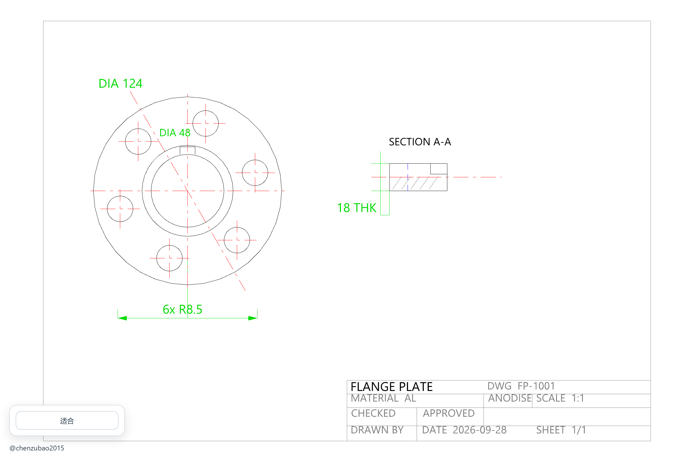

# QuickLook.Plugin.CadViewer

A **QuickLook** plugin that previews 2D CAD drawings — **DXF** and **DWG** — with a simple
spacebar, without opening AutoCAD and without uploading anything anywhere.



<p align="center"><em>Left-click drag to pan, wheel to zoom. The button and author link stay out of the way in the bottom-left corner.</em></p>

## Features

- **DXF and DWG in one plugin.** `.dxf` is rendered by a WebGL renderer; `.dwg` is decoded locally
  by LibreDWG compiled to WebAssembly.
- **Zoom and pan.** Wheel zoom keeps the point under the cursor in place, so you can zoom
  straight into a detail. Left-click drag moves the sheet around to reveal whatever a zoomed
  view pushed off screen.
- **Fit button** returns to the whole sheet after you have moved around.
- **Fully offline.** The drawing never leaves the machine, and no external service is contacted.
- **Layer fidelity for DXF.** Layers, colours, blocks, hatches, dimensions and text are rendered.
- **Readable on a light background.** Colours that would be invisible on white are darkened
  automatically, keeping their hue.
- **Text without shipping fonts.** Glyphs come from fonts already installed on Windows
  (Segoe UI / Arial, plus SimHei / SimKai / SimFang for Chinese drawings), loaded on demand.
- **Path safe.** Drawings in folders with spaces or non-ASCII characters open correctly.
- **Light and dark aware UI**, high-DPI friendly.

## Installation

1. Download `QuickLook.Plugin.CadViewer.qlplugin` from the
   [latest release](../../releases/latest).
2. With QuickLook running, select the downloaded file and press <kbd>Space</kbd>.
3. Click **Install**, then restart QuickLook.
4. Select any `.dxf` or `.dwg` file and press <kbd>Space</kbd>.

**Requirements:** QuickLook 4.x, Windows 10/11, and the Microsoft Edge WebView2 Runtime
(already present on most Windows 10/11 systems).

## Usage

| Action | Result |
| --- | --- |
| Mouse wheel | Zoom in / out around the cursor |
| Left-click drag | Pan the drawing |
| **Fit** button | Restore the whole-sheet view |

## Supported formats

| Extension | Format | Renderer |
| --- | --- | --- |
| `.dxf` | AutoCAD Drawing Exchange Format | WebGL renderer (blocks, hatches, dimensions, text) |
| `.dwg` | AutoCAD binary drawing | LibreDWG (WebAssembly) decoded to vector output |

## How it works

The plugin is a thin WPF host around a self-contained web view:

1. `Plugin.cs` implements QuickLook's `IViewer` and claims `.dxf` / `.dwg`.
2. `CadViewerPanel.cs` hosts WebView2 and exposes three virtual hosts — the viewer assets, the
   folder containing the drawing, and the Windows font folder — so the page can read files
   without any temporary copies and without file-system access from script.
3. `Web/app.src.js` renders the drawing and owns all interaction. DXF goes through
   [dxf-viewer](https://github.com/vagran/dxf-viewer); DWG is decoded by
   [libredwg-web](https://github.com/mlightcad/libredwg-web) and drawn as vector geometry.

Because everything is local, previewing a customer drawing does not disclose it.

## Building from source

**Prerequisites:** Node.js 18+, .NET 8 SDK (used to build the .NET Framework 4.6.2 plugin),
Windows.

```powershell
git clone https://github.com/chenzubao2015/QuickLook.Plugin.CadViewer.git
cd QuickLook.Plugin.CadViewer

# Produces QuickLook.Plugin.CadViewer.qlplugin
powershell -ExecutionPolicy Bypass -File .\Scripts\pack.ps1

# Or just build into Build\Release without packaging
powershell -ExecutionPolicy Bypass -File .\Scripts\build.ps1
```

The build installs the npm dependencies, copies the LibreDWG WebAssembly module into
`Web/vendor`, bundles `Web/app.src.js` with esbuild, and compiles the C# plugin.

```
QuickLook.Plugin.CadViewer/
├── Plugin.cs                       IViewer implementation (file extensions, lifecycle)
├── CadViewerPanel.cs               WebView2 host, virtual-host mapping, font discovery
├── Web/
│   ├── index.html, app.css         Preview UI
│   ├── app.src.js                  Rendering, zoom, pan, colour adaptation (source)
│   └── app.js                      esbuild output (generated)
├── Scripts/                        build / pack / source-package scripts
├── tools/make-demo-dxf.py          Regenerates the demo drawing used in the screenshots
└── docs/                           Screenshots and the demo drawing
```

## Known limitations

- DWG decoding relies on LibreDWG, which supports a large but not complete subset of entities.
  Table entities (`ACAD_TABLE`) abort its converter, so they are skipped before conversion;
  the rest of the drawing still renders. `MLINE`, `MULTILEADER` and `3DSOLID` may be incomplete.
- If a drawing contains an entity far away from the main geometry, the fit view honours the true
  extents and the main content appears small — zoom in to inspect it.
- DXF rendering is the higher-fidelity path; for best results prefer DXF over DWG when both are
  available.
- Annotations using SHX-only big fonts are drawn with the installed TrueType fallback, so glyph
  shapes can differ from AutoCAD.

## Troubleshooting

**The preview stays on the loading screen.** Make sure the Microsoft Edge WebView2 Runtime is
installed, then restart QuickLook completely from the system tray.

**"无法预览此 CAD 文件" / "Cannot preview this CAD file".** The message under the title explains
the cause. Very old or very new DWG versions may not be supported by LibreDWG.

**Text is missing or shows boxes.** The drawing uses a font that is not installed. Install the
font referenced by the drawing, or ask for a DXF export.

**A stale layout appears after updating.** The viewer bypasses the cache itself; if you still see
an old version, exit QuickLook from the tray icon rather than just closing the preview.

## Contributing

Issues and pull requests are welcome — see [CONTRIBUTING.md](CONTRIBUTING.md).

## Credits

Built on the shoulders of these projects:

- [QuickLook](https://github.com/QL-Win/QuickLook) — the preview host
- [dxf-viewer](https://github.com/vagran/dxf-viewer) — DXF rendering (MPL-2.0)
- [LibreDWG](https://github.com/LibreDWG/libredwg) and
  [libredwg-web](https://github.com/mlightcad/libredwg-web) — DWG decoding (GPL-3.0)
- [three.js](https://github.com/mrdoob/three.js) (MIT), [opentype.js](https://github.com/opentypejs/opentype.js) (MIT),
  [earcut](https://github.com/mapbox/earcut) (ISC), [loglevel](https://github.com/pimterry/loglevel) (MIT)

Inspired by [QuickLook.Plugin.CADImport](https://github.com/emako/QuickLook.Plugin.CADImport),
which takes a different (commercial-library) approach to the same problem.

## License

GPL-3.0, because the bundled LibreDWG WebAssembly component is GPL-3.0. See [LICENSE](LICENSE)
and [THIRD-PARTY-NOTICES.txt](THIRD-PARTY-NOTICES.txt).

## Author

[@chenzubao2015](https://github.com/chenzubao2015)
