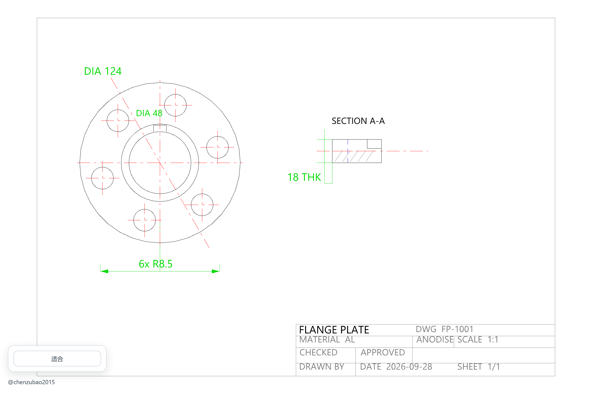

# QuickLook.Plugin.CadViewer

[English](README.md) | **中文**

一个 [QuickLook](https://github.com/QL-Win/QuickLook) 插件：按空格即可预览 **DXF / DWG** 二维图纸，
不用打开 AutoCAD，也不会上传任何文件。



<p align="center"><em>左键拖动平移，滚轮缩放；按钮与作者信息固定在左下角，不遮挡图纸。</em></p>

## 功能

- **一个插件同时支持 DXF 与 DWG**。`.dxf` 由 WebGL 渲染；`.dwg` 由编译为 WebAssembly 的
  LibreDWG 在本地解码。
- **缩放与平移**。滚轮以光标位置为中心缩放，可直接放大到某个细节；左键拖动移动图纸，
  查看放大后被移出画面的内容。
- **“适合”按钮**：移动后一键回到整图视图。
- **完全离线**。图纸不会离开本机，不访问任何外部服务。
- **DXF 图层保真**。图层、颜色、块、填充、标注与文字都会渲染。
- **浅色背景下清晰**。过亮的线色会自动压暗并保留色相，避免白底白线。
- **不携带字体文件**。文字使用系统已安装字体（Segoe UI / Arial，以及 SimHei、SimKai、SimFang 等中文字体），
  按需加载。
- **路径安全**。图纸位于含空格或中文的目录下也能正常预览。

## 安装

1. 从 [最新发布](../../releases/latest) 下载 `QuickLook.Plugin.CadViewer.qlplugin`。
2. 保持 QuickLook 运行，选中该文件并按 <kbd>空格</kbd>。
3. 点击 **Install**，然后重启 QuickLook。
4. 选中任意 `.dxf` 或 `.dwg` 文件并按 <kbd>空格</kbd> 预览。

**环境要求**：QuickLook 4.x、Windows 10/11、Microsoft Edge WebView2 运行时
（多数 Windows 10/11 已自带）。

## 操作方式

| 操作 | 效果 |
| --- | --- |
| 鼠标滚轮 | 以光标为中心缩放 |
| 按住左键拖动 | 平移图纸 |
| **适合** 按钮 | 恢复整图视图 |

## 支持的格式

| 扩展名 | 格式 | 渲染方式 |
| --- | --- | --- |
| `.dxf` | AutoCAD Drawing Exchange Format | WebGL 渲染（块、填充、标注、文字） |
| `.dwg` | AutoCAD 二进制图纸 | LibreDWG（WebAssembly）解码为矢量后渲染 |

## 实现原理

插件本体是一个很薄的 WPF 宿主，真正的工作由内嵌网页完成：

1. `Plugin.cs` 实现 QuickLook 的 `IViewer`，声明 `.dxf` / `.dwg`。
2. `CadViewerPanel.cs` 承载 WebView2，并映射三个虚拟主机——预览资源目录、图纸所在目录、
   Windows 字体目录，使页面无需复制临时文件即可读取图纸。
3. `Web/app.src.js` 负责渲染与全部交互。DXF 由
   [dxf-viewer](https://github.com/vagran/dxf-viewer) 渲染；DWG 由
   [libredwg-web](https://github.com/mlightcad/libredwg-web) 解码后以矢量绘制。

因为全部在本地完成，预览客户图纸不会造成图纸外泄。

## 从源码构建

**依赖**：Node.js 18+、.NET 8 SDK（用于构建目标为 .NET Framework 4.6.2 的插件）、Windows。

```powershell
git clone https://github.com/chenzubao2015/QuickLook.Plugin.CadViewer.git
cd QuickLook.Plugin.CadViewer

# 生成 QuickLook.Plugin.CadViewer.qlplugin
powershell -ExecutionPolicy Bypass -File .\Scripts\pack.ps1

# 或仅构建到 Build\Release，不打包
powershell -ExecutionPolicy Bypass -File .\Scripts\build.ps1
```

构建过程会安装 npm 依赖、把 LibreDWG 的 WebAssembly 模块复制到 `Web/vendor`、
用 esbuild 打包 `Web/app.src.js`，最后编译 C# 插件。

```
QuickLook.Plugin.CadViewer/
├── Plugin.cs                       IViewer 实现（扩展名与生命周期）
├── CadViewerPanel.cs               WebView2 宿主、虚拟主机映射、字体探测
├── Web/
│   ├── index.html, app.css         预览界面
│   ├── app.src.js                  渲染、缩放、平移、颜色适配（源码）
│   └── app.js                      esbuild 产物（生成）
├── Scripts/                        构建 / 打包 / 源码打包脚本
├── tools/make-demo-dxf.py          生成截图所用演示图纸
└── docs/                           截图与演示图纸
```

## 已知限制

- DWG 解码依赖 LibreDWG，其支持的实体集合并不完整。表格实体（`ACAD_TABLE`）会使其转换器
  中断，因此转换前会被跳过，图纸其余内容仍正常显示；`MLINE`、`MULTILEADER`、`3DSOLID`
  等实体可能显示不完整。
- 若图纸存在远离主体图形的离群实体，整图视图会以真实范围为准，主体内容因此显得较小，
  可放大查看。
- DXF 渲染保真度高于 DWG；两者都有时建议优先使用 DXF。
- 使用 SHX 大字体的标注将使用系统 TrueType 字体回退，字形可能与 AutoCAD 不同。

## 常见问题

**一直停留在加载界面。** 请确认已安装 Microsoft Edge WebView2 运行时，然后从系统托盘完全
退出并重启 QuickLook。

**提示“无法预览此 CAD 文件”。** 标题下方的信息会说明原因。过旧或过新的 DWG 版本可能不被
LibreDWG 支持。

**文字缺失或显示为方框。** 图纸使用的字体未安装。安装图纸所引用的字体，或请对方提供 DXF。

**更新后仍是旧界面。** 预览页面已自行绕过缓存；若仍显示旧版本，请从托盘图标退出 QuickLook，
而不是仅关闭预览窗口。

## 参与贡献

欢迎提交 Issue 与 Pull Request，详见 [CONTRIBUTING.md](CONTRIBUTING.md)。

## 致谢

本插件基于以下开源项目：

- [QuickLook](https://github.com/QL-Win/QuickLook) —— 预览宿主
- [dxf-viewer](https://github.com/vagran/dxf-viewer) —— DXF 渲染（MPL-2.0）
- [LibreDWG](https://github.com/LibreDWG/libredwg) 与
  [libredwg-web](https://github.com/mlightcad/libredwg-web) —— DWG 解码（GPL-3.0）
- [three.js](https://github.com/mrdoob/three.js)（MIT）、
  [opentype.js](https://github.com/opentypejs/opentype.js)（MIT）、
  [earcut](https://github.com/mapbox/earcut)（ISC）、
  [loglevel](https://github.com/pimterry/loglevel)（MIT）

思路参考了 [QuickLook.Plugin.CADImport](https://github.com/emako/QuickLook.Plugin.CADImport)，
该项目用商业库解决同一问题，本插件改用全开源方案。

## 许可证

GPL-3.0，因为内置的 LibreDWG WebAssembly 组件为 GPL-3.0。详见 [LICENSE](LICENSE) 与
[THIRD-PARTY-NOTICES.txt](THIRD-PARTY-NOTICES.txt)。

## 作者

[@chenzubao2015](https://github.com/chenzubao2015)
